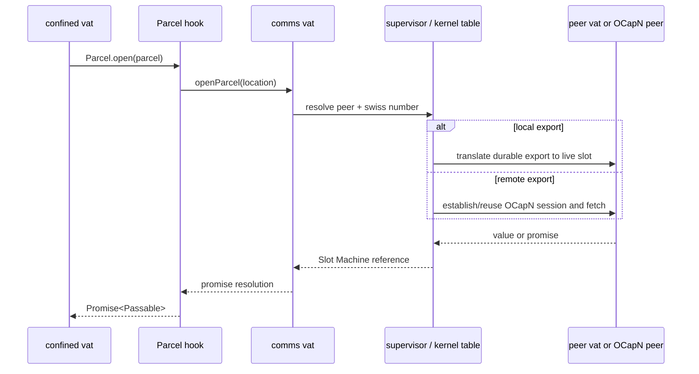

# Parcels Across Slot Machine

| | |
|---|---|
| **Created** | 2026-06-23 |
| **Updated** | 2026-10-15 |
| **Author** | endolinbot (prompted) |
| **Status** | Proposed |

## Status

This design is not superseded by [`parcel.md`](parcel.md).
Parcel supersedes its former language-level SturdyRef design, but exposes the
transport question that remains here: how a Slot Machine vat passes and opens a
Parcel without learning its location.

This is a transformative rewrite of the former `endor`-syscall retention plan.
It removes the duplicate pass-style, marshal, and OCapN design; removes the
proposed `retain` / `release` syscalls; and treats Slot Machine as a CapTP
variant rather than a syscall bus.

## Problem

A Parcel is dormant authority. It carries a hidden location and an `open` hook,
but it does not manifest or retain its target merely by crossing a vat boundary.
The language-level contract is already settled in [`parcel.md`](parcel.md):

- the pass style is `'parcel'`;
- trusted code can read a location with `%InitialParcel%.locate`;
- confined vats receive `%SharedParcel%`, which can construct, recognize, and
  open Parcels but cannot locate them;
- ordinary marshal encodes a Parcel inline rather than allocating a live slot;
- `Parcel.open(parcel)` and `E.open(parcel)` return a promise for the acquired
  value.

Slot Machine must preserve those properties while carrying Parcels among local
vats, peer vats, and vats reachable over OCapN. In particular, a confined vat
must be able to open a Parcel without receiving its cryptographic location.

The old design framed this as an `endor` syscall for retaining a SturdyRef. That
is the wrong boundary. Slot Machine already carries capability operations and
promise resolutions. Opening a Parcel is an ordinary capability request to a
closely held communications capability, and its result is an ordinary Slot
Machine object or promise reference.

## Existing Slot Machine Wire Format

The implementation merged in #124 and refined in #990 is concrete enough to
anchor this design.

Slot Machine has a canonical-CBOR envelope with seven capability-protocol
verbs:

```text
deliver  get  index  untag  resolve  drop  abort
```

`deliver` and `resolve` each carry a Smallcaps body as UTF-8 bytes plus arrays
of descriptors. A descriptor is the two-element CBOR array
`[kindByte, position]`; its kind distinguishes object, promise, answer, and
device references. The supervisor translates descriptors but does not decode
the Smallcaps body. `get`, `index`, and `untag` have dedicated scalar payloads.

This is a CapTP variant: a c-list maps values to per-session descriptors,
deliveries produce reply promises, resolutions settle them, and `drop` performs
distributed reference release. The outer canonical CBOR is transport framing;
the inner Smallcaps body is the passable-value representation.

That separation is important. A Parcel is pass-by-copy dormant authority, not
a live c-list object. It belongs in the inner body and does not require an
eighth envelope verb or a new descriptor kind.

## Design

### Parcel representation

Slot Machine uses the Parcel Smallcaps form from [`parcel.md`](parcel.md): an
apostrophe followed immediately by the location. For example, a complete body
containing only one Parcel can have the form:

```text
#"'#ocapn=1&peer=ed25519hex&value=rand256hex"
```

The `targets` and `promises` descriptor arrays remain empty for that value.
When a Parcel occurs among other passables, its inline encoding occurs in the
same Smallcaps body and live references elsewhere in that body continue to use
ordinary descriptors.

The outer Slot Machine canonical-CBOR payload does not acquire an
`ocapn-sturdyref` record. That tag belongs to the OCapN wire codec. The Slot
Machine endpoint converts between its inline Parcel representation and OCapN's
structured locator only when it crosses an OCapN session.

The supervisor continues to translate descriptors without interpreting the
Smallcaps body. A trusted endpoint codec owns Parcel encode and decode callbacks
alongside the c-list codec.

### Endpoint authority

The Slot Machine endpoint retains `%InitialParcel%` authority during bootstrap.
It does not endow that constructor to guest code.

On encode, the endpoint callback:

1. recognizes a Parcel;
2. obtains its string location with the retained `Parcel.locate` authority;
3. writes the inline Smallcaps form.

On decode, the endpoint callback:

1. validates the inline string as a location accepted by its communications
   policy;
2. constructs a Parcel with an endpoint-owned open hook;
3. gives the guest only the resulting Parcel through `%SharedParcel%`.

The callback necessarily sees a location because it is the transport's trusted
authority boundary. The guest sees an opaque `Parcel {}` and can neither locate
it nor make a generic serializer reveal it.

### Opening through the communications vat

Each Slot Machine client receives a closely held communications capability
during bootstrap. The endpoint-owned open hook closes over that capability:

```js
const open = location => E(commsVat).openParcel(location);
const parcel = new Parcel(location, open);
```

The exact bootstrap property name is an implementation choice; the semantic
operation is `openParcel(location) -> Promise<Passable>`.

`Parcel.open(parcel)` invokes the hook in a later turn. The hook performs an
ordinary Slot Machine `deliver` to the communications vat, and the returned
promise is represented by the ordinary reply descriptor. There is no `open`
wire verb and no Parcel-specific syscall.

The communications vat parses and routes the location:

- **same vat:** resolve directly to the value or promise already represented in
  that vat;
- **peer local vat:** ask the supervisor's kernel table to translate the durable
  export to a target vat and return a Slot Machine presence or promise;
- **OCapN peer:** establish or reuse the OCapN session, fetch the swiss number
  from that peer's bootstrap, and return the resulting presence or promise.

All three paths settle the same promise returned by `Parcel.open`. The client
cannot distinguish the path except by the behavior and timing of the referent.
It never receives the location as data.



### Addressing and key ownership

Passing Parcels among vats requires every durable export to be reachable through
a cryptographic peer identity. It does not require an independent key pair for
every vat.

The default topology is the OCap Kernel / SwingSet / Liveslots shape:

- the supervisor or communications service owns one host peer key, or one key
  per deliberately isolated guest shard;
- a persistent kernel table maps `(peer key, swiss number)` to a vat and that
  vat's durable export;
- each live Slot Machine session maps kernel references to its local vat
  descriptors;
- local opens use the same table but short-circuit the network hop.

A Parcel location therefore addresses the communications service, not a vat
process. The swiss number selects an export whose table entry identifies the
vat. Restarting or moving a vat does not change the location while that mapping
remains valid.

Per-vat key pairs remain an optional deployment policy for vats that must have
independent identity, revocation, migration, or disclosure domains. They are not
the default representation because they multiply durable key custody and
session establishment without improving confinement inside one supervisor.
Guest-sharded keys provide the intermediate isolation point: vats in a shard
share a peer identity, while one guest's exports need not be linkable to another
guest's peer key.

The key owner also owns location minting. Guest vats may ask the communications
vat to create a Parcel for a value, but they do not receive the location unless
separately endowed with location authority.

### Lifetime, retention, and revocation

A Parcel does not retain an incarnation. Passing or storing it copies dormant
authority and creates no live descriptor. Opening it creates an ordinary live
reference, after which Slot Machine's existing c-list, `drop`, promise, and
supervisor-retention rules apply.

This removes the former design's `retain` / `release` syscall pair:

- retaining a Parcel means retaining the inert Parcel value in the vat's own
  durable state;
- retaining an opened target means retaining its ordinary Slot Machine
  reference;
- dropping the opened target uses the existing `drop` lane;
- no `ephemeral:<worker>:<turn>` or `retained:<worker>:<handle>` formula-graph
  edge is introduced merely for possession of a Parcel.

Revocation acts at the durable export table. Deleting or disabling the
`(peer key, swiss number)` mapping makes subsequent opens reject, while already
opened references follow the normal live-reference revocation and termination
rules. The user-facing retention surface should distinguish these states:

| State | Retains an incarnation? | Revocation surface |
|---|---:|---|
| Parcel merely stored in a vat | no | durable export mapping |
| Parcel open in flight | only protocol work needed for the request | request/session cancellation |
| Opened presence or promise retained | yes, under existing live-reference rules | vat/session retention path |

This preserves both desired properties: dormant references do not force their
targets alive, and every live retention root remains attributable to a vat or
session the user can terminate.

### Provenance

The shared Parcel constructor proves realm membership, not provenance. A guest
can construct a Parcel around a location and a guest-supplied hook. Trusted code
must not call `Parcel.open` on a Parcel from a source it would not allow to run
code.

Transport crossing changes that provenance. When a trusted endpoint serializes
a Parcel, it transmits only the located string. The receiving endpoint builds a
new Parcel with its own communications-vat hook; the sender's hook does not
cross. The receiving communications policy decides whether the location scheme
and peer are admissible.

## Failure Semantics

- A malformed inline Parcel representation is a marshal error and rejects the
  containing delivery or resolution.
- A syntactically valid but disallowed location decodes only if policy permits
  making an inert Parcel for it; otherwise decode rejects before guest delivery.
- An unknown or revoked swiss number makes `openParcel` reject. It does not
  abort the Slot Machine session.
- Failure to establish an OCapN session rejects the open promise and leaves the
  Parcel reusable for a later attempt.
- A communications-vat termination rejects outstanding opens through ordinary
  promise resolution or session abort behavior.
- Opening twice dispatches twice. Session reuse and referent identity are
  communications policy, not Parcel guarantees.

## Staged Implementation

1. **Endpoint codec.** Teach the Slot Machine Smallcaps marshal callbacks to
   encode and decode Parcels inline. Keep descriptor translation opaque to the
   body. Add byte fixtures in JavaScript and Rust showing the outer canonical
   CBOR is unchanged except for body bytes.
2. **Communications capability.** Add the privileged `openParcel` capability to
   client bootstrap and bind decoded Parcels to it. Exercise local-vat and
   peer-vat opens through ordinary delivery and promise resolution.
3. **Persistent export table.** Map host/shard peer keys and swiss numbers to vat
   exports across restart. Add mint, revoke, and missing-export paths.
4. **OCapN bridge.** Translate Parcel locations to the existing
   `ocapn-sturdyref` wire record at the external boundary and return the fetched
   reference over Slot Machine.
5. **User surface.** Show live opened references in existing retention paths and
   expose dormant-export revocation separately; do not report an inert stored
   Parcel as a live incarnation root.

## Test Plan

- JavaScript and Rust accept byte-identical Slot Machine frames containing one
  Parcel, a Parcel nested in copy data, and a mixture of a Parcel and live slots.
- A decoded guest Parcel has pass style `'parcel'`, opens successfully, and does
  not reveal its location through `%SharedParcel%` or generic marshal.
- The supervisor can forward a Parcel body without decoding it.
- Opening a local-vat Parcel returns the local target through a normal promise
  descriptor.
- Opening a peer-local-vat Parcel routes through the persistent kernel table and
  preserves vat-slot isolation.
- Opening an OCapN Parcel emits the existing `ocapn-sturdyref` representation
  only at the OCapN boundary.
- Revoking the durable export makes a later open reject while merely storing the
  Parcel never incarnates the target.
- A vat crash drops opened live references according to existing Slot Machine
  rules but does not corrupt the durable export table.
- A forged prototype fails the Parcel brand check, and a guest-supplied hook is
  never transmitted to another endpoint.

## Design Decisions

1. Slot Machine is a CapTP variant, not a syscall surface for Parcel passing.
2. Parcels are inline Smallcaps values and do not consume descriptors.
3. Opening is an ordinary delivery to a closely held communications vat and
   returns an ordinary promise reference.
4. The supervisor maps durable kernel references to vat slots under a host or
   guest-shard key by default; per-vat key pairs are optional policy.
5. The old explicit `retain` / `release` protocol is removed. Parcel possession
   is dormant; only the opened result participates in live retention.
6. `ocapn-sturdyref` remains an OCapN boundary representation and does not become
   a Slot Machine envelope type.

## Open Questions

- What is the durable schema and rotation procedure for host and guest-shard
  peer keys and their swiss-number export table?
- Should a decoder admit an inert Parcel for a syntactically valid but presently
  unsupported location scheme, or reject it immediately by policy?
- Which user-facing command revokes a dormant export mapping, and how does it
  report already opened live references that survive that revocation?

## Dependencies

| Design or implementation | Relationship |
|---|---|
| [`parcel.md`](parcel.md) | Canonical language surface, authority split, inline marshal representation, and OCapN mapping. |
| #124 (`slot-machine`) | Merged concrete canonical-CBOR envelope, descriptor, c-list, and Smallcaps-body implementation. |
| #990 (`slots-ocapn-op-lanes`) | Seven-verb Slot Machine operation lanes and OCapN-compatible call convention. |
| [`cbor-codec.md`](cbor-codec.md) | Shared canonical-CBOR primitives used by JavaScript and Rust Slot Machine codecs. |
| [`daemon-cross-peer-gc.md`](daemon-cross-peer-gc.md) | Existing live-reference retention and cross-peer collection substrate. |
| [`daemon-retention-paths.md`](daemon-retention-paths.md) | User-visible live retention roots. |
| [`ironhorse-panic.md`](ironhorse-panic.md) | Slot Machine ownership of vat lifecycle, transcript, and recovery. |

## Prompt

The original 2026-06-23 prompt asked for a competing plan in which the daemon
retained SturdyRefs on behalf of workers through `retain` and `release` syscalls.
That direction was later abandoned.

The 2026-10-15 review of #1460 asked whether this design was actually
superseded in light of Parcel, observed that Slot Machine is a CapTP variant with
an OCapN-like CBOR representation, rejected "syscall" as the framing for Parcel
passing, and required a communications-vat path for opening Parcels from local,
peer-local, or OCapN vats. It also raised the peer-key topology question. This
rewrite is the resulting design.
